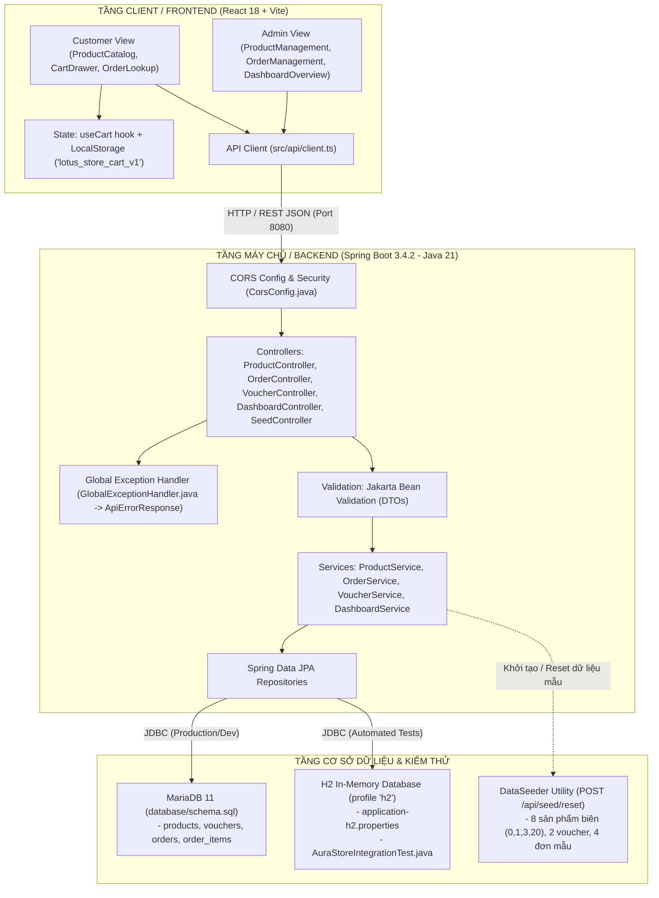

# KIẾN TRÚC CÔNG NGHỆ HỆ THỐNG LOTUS STORE
## MINH CHỨNG KỸ THUẬT PHỤC VỤ SQA & KIỂM THỬ PHẦN MỀM

**Dự án:** Lotus Store – Hệ thống Thương mại điện tử Bán hàng trực tuyến  
**Học phần:** Đảm bảo và kiểm soát chất lượng phần mềm (SQA/QC) – UEH  
**Kho lưu trữ mã nguồn:** [https://github.com/rtmiue20/SQAQC.git](https://github.com/rtmiue20/SQAQC.git)  

---

## 1. Sơ đồ Kiến trúc Tổng thể (High-Level Architecture)

Hệ thống Lotus Store được xây dựng theo kiến trúc phân tầng chuẩn (Layered Architecture), tách biệt hoàn toàn giữa Tầng Trình diễn (Presentation Layer - Frontend SPA) và Tầng Xử lý Nghiệp vụ / Dữ liệu (Backend REST API & Database):

---

## 2. Phân hệ Backend (thư mục `backend/`)

### 2.1. Cấu hình Công nghệ
- **Ngôn ngữ:** Java 21 (LTS).
- **Khung ứng dụng:** Spring Boot 3.4.2 với Spring Web MVC, Spring Data JPA, Spring Validation.
- **Build tool:** Apache Maven Wrapper (`backend/mvnw`).
- **Tổ chức Package:** `com.aurastore`
  - `com.aurastore.controller`: Điểm tiếp nhận request RESTful API.
  - `com.aurastore.service`: Logic xử lý nghiệp vụ, quản lý giao dịch `@Transactional`.
  - `com.aurastore.repository`: Tương tác cơ sở dữ liệu qua Spring Data JPA interfaces.
  - `com.aurastore.model`: Các thực thể dữ liệu JPA (`Product`, `Order`, `OrderItem`, `Voucher`, `OrderStatus`, `DiscountType`).
  - `com.aurastore.dto`: Đối tượng truyền nhận dữ liệu (`CreateOrderRequest`, `ProductRequest`, `VoucherValidateRequest`, v.v.).
  - `com.aurastore.config`: Cấu hình hệ thống (`CorsConfig`, `DataSeeder`).
  - `com.aurastore.exception`: Xử lý ngoại lệ (`GlobalExceptionHandler`, `BusinessException`, `ResourceNotFoundException`).

### 2.2. Kiểm soát chia sẻ tài nguyên nguồn gốc chéo (CORS)
Được cấu hình tại `CorsConfig.java`, cho phép frontend kết nối an toàn từ `http://localhost:5173` và các origin phát triển khác, hỗ trợ đầy đủ các phương thức HTTP: `GET`, `POST`, `PUT`, `PATCH`, `DELETE`, `OPTIONS`.

### 2.3. Kiểm tra dữ liệu đầu vào và Xử lý ngoại lệ tập trung
- **Bean Validation:** Sử dụng các chú thích chuẩn `@NotBlank`, `@NotNull`, `@Min`, `@Pattern` trên các DTO để chặn các dữ liệu không hợp lệ trước khi vào tầng Service.
- **Global Exception Handler:** Bắt giữ toàn bộ ngoại lệ phát sinh (`MethodArgumentNotValidException`, `BusinessException`, `ResourceNotFoundException`, `Exception`) và ánh xạ về định dạng phản hồi chuẩn `ApiErrorResponse` kèm mã trạng thái HTTP thích hợp (400 Bad Request, 404 Not Found, 500 Internal Server Error).

---

## 3. Phân hệ Frontend (thư mục `frontend/`)

### 3.1. Cấu hình Công nghệ
- **Nền tảng:** React 18 với ngôn ngữ TypeScript, xây dựng trên nền Vite 6.
- **Khung giao diện:** Tailwind CSS v3 định kiểu linh hoạt, hiện đại.
- **Cấu trúc thư mục:**
  - `src/components/customer/`: Luồng nghiệp vụ dành cho khách hàng (`ProductCatalog`, `ProductCard`, `CartDrawer`, `OrderLookup`, `HeroBanner`).
  - `src/components/admin/`: Luồng nghiệp vụ dành cho ban quản trị (`ProductManagement`, `ProductFormModal`, `OrderManagement`, `DashboardOverview`).
  - `src/hooks/useCart.ts`: Custom React hook quản lý trạng thái giỏ hàng độc lập.
  - `src/api/client.ts`: Module đóng gói gọi API Backend qua Fetch API.

### 3.2. Quản lý Trạng thái Giỏ hàng và Tính bền vững
- Hook `useCart.ts` cung cấp các thao tác: `addItem`, `removeItem`, `updateQuantity`, `clearCart`, và tính `subtotal`.
- Dữ liệu giỏ hàng được đồng bộ tự động vào `localStorage` với khóa `lotus_store_cart_v1`. Khi người dùng làm mới trang (F5) hoặc mở tab mới, giỏ hàng được nạp lại tức thì, đảm bảo trải nghiệm người dùng liền mạch.

---

## 4. Tầng Dữ liệu và Môi trường Kiểm thử

### 4.1. Lược đồ Cơ sở Dữ liệu (`database/schema.sql`)
Gồm 4 bảng chuẩn hóa:
1. `products`: Lưu trữ thông tin sản phẩm (`id`, `name`, `category`, `price`, `stock`, `image_url`, `description`, `active`, `created_at`, `updated_at`).
2. `vouchers`: Lưu trữ thông tin mã giảm giá (`id`, `code`, `discount_type`, `discount_value`, `min_order_amount`, `max_discount`, `active`, `expiry_date`).
3. `orders`: Lưu trữ thông tin đơn hàng (`id`, `order_code`, `customer_name`, `phone`, `address`, `subtotal`, `discount_amount`, `final_total`, `status`, `voucher_code`, `created_at`, `updated_at`).
4. `order_items`: Chi tiết sản phẩm trong đơn hàng (`id`, `order_id`, `product_id`, `product_name`, `price`, `quantity`, `subtotal`).

### 4.2. Cấu hình Kiểm thử Tự động với H2 In-Memory
- Hồ sơ kiểm thử: Spring Profile `h2` (`backend/src/main/resources/application-h2.properties` và `backend/src/test/resources/application-test.properties`).
- Cho phép chạy toàn bộ bộ kiểm thử tự động `AuraStoreIntegrationTest.java` qua lệnh `mvnw test` độc lập, không phụ thuộc vào việc phải cài đặt hoặc khởi động MariaDB server, giúp tăng tốc độ kiểm thử và chống ô nhiễm dữ liệu giữa các lần chạy.

### 4.3. Tiện ích Seed Data (`DataSeeder.java`)
Cung cấp API `POST /api/seed/reset` hỗ trợ đắc lực cho hoạt động kiểm thử hồi quy và kiểm thử thủ công:
- **8 sản phẩm mẫu biên:**
  - Áo sơ mi công sở (tồn kho: 20)
  - Quần jeans Slimfit (tồn kho: 1 - biên tối thiểu)
  - Tai nghe Bluetooth Pro (tồn kho: 0 - biên hết hàng)
  - Balo laptop chống nước (tồn kho: 3 - biên cảnh báo sắp hết)
  - Cùng 4 sản phẩm đa dạng khác.
- **2 Voucher chuẩn:**
  - `UEH10`: Giảm 10%, trần tối đa 50.000đ, áp dụng đơn $\ge 200.000$đ.
  - `FREESHIP`: Giảm 30.000đ, áp dụng đơn $\ge 100.000$đ.
- **4 Đơn hàng mẫu:** `ORD-1001` (PENDING), `ORD-1002` (SHIPPING), `ORD-1003` (COMPLETED), `ORD-1004` (CANCELLED).
